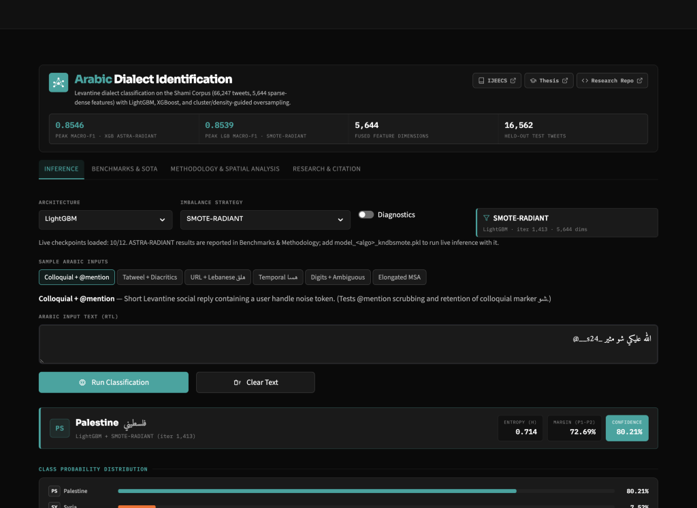

# Arabic Dialect Identification — Interactive Demo

[](https://arabic-dialect-identification.streamlit.app)
[](https://www.python.org/)
[](https://opensource.org/licenses/MIT)

An interactive Streamlit-based dashboard for **Levantine Arabic Dialect Identification** using feature-engineered machine learning models with imbalance-aware training strategies.

This demo provides real-time inference and qualitative analysis for Arabic dialect classification across four Levantine dialects:

- 🇸🇾 Syrian
- 🇱🇧 Lebanese
- 🇵🇸 Palestinian
- 🇯🇴 Jordanian

---

## 🌐 Live Demo

👉 https://arabic-dialect-identification.streamlit.app

---

## 🧠 Features

### 🔹 Interactive Inference
Predict Arabic dialects directly from raw Arabic text input.

### 🔹 Batch Processing
Run inference on multiple Arabic sentences simultaneously and export predictions as CSV.

### 🔹 Probability Visualization
Inspect confidence distributions across Levantine dialect classes.

### 🔹 Preprocessing Diagnostics
Analyze:
- Cleaning
- Normalization
- Character-stream transformation
- Tokenization behavior

### 🔹 Experiment Configuration
Compare multiple imbalance-handling strategies:

- Original
- SMOTE
- ASTRA-SMOTE
- SMOTE-RADIANT
- Balanced Weighting

### 🔹 Robust Invalid Input Detection
Inputs without sufficient Arabic dialectal content are automatically rejected as:

> *Dialect Not Detected*

---

## 🖼️ Dashboard Preview



---

## ⚙️ Local Installation

It is recommended to use a virtual environment.

### 1. Clone Repository

```bash
git clone https://github.com/moel-ihsan/arabic-dialect-id-demo.git
cd arabic-dialect-id-demo
```

### 2. Create Virtual Environment

```bash
python -m venv .venv
```
### 3. Activate Environment

Linux/macOS:

```bash
source .venv/bin/activate
```

Windows:

```bash
.venv\Scripts\activate
```

### 4. Install Dependencies

```bash
pip install -r requirements.txt
```

## 📦 Required Artifacts

This demo depends on pretrained inference artifacts:

- `model_*.pkl`
- `shami_feature_extractor.pkl`
- `label_encoder.pkl`

These assets are managed using **Git LFS** due to their large size.

---

## 🧪 Model Overview

The dashboard supports:

- LightGBM
- XGBoost

with several imbalance mitigation strategies evaluated in the associated research project.

The proposed **SMOTE-RADIANT** configuration achieved the strongest overall performance in highly sparse Arabic dialect feature space.

---

## 🔬 Related Research

This demo is derived from the research project:

> **Evaluating Oversampling Methods for Imbalanced Arabic Dialect Identification**

The full experimental pipeline and research repository are available here:

👉 https://github.com/moel-ihsan/Arabic-Dialect-Identification

---

## 👥 Authors

- **Maulana Ihsan Ahmad**
- **Aina Musdholifah**
- **Arif Nurwidyantoro**

Department of Computer Science and Electronics  
Universitas Gadjah Mada, Indonesia